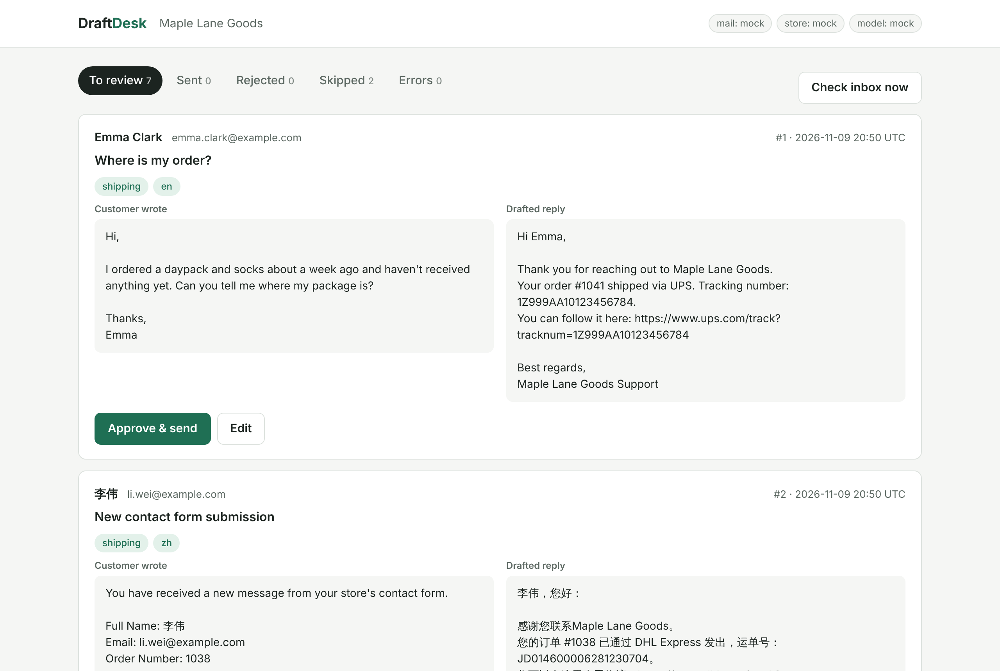
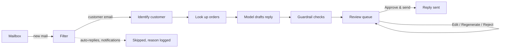

# DraftDesk

**AI drafts the reply. A person approves it with one click. Nothing is sent without that click.**

DraftDesk watches a support mailbox, looks up the customer's orders in your store, has a language model write a reply from your own policies, and puts the draft in a review queue. It works with any e-commerce platform, any mailbox and any model through three small adapter interfaces.

[中文说明](README.zh-CN.md)



## Try it in one minute

No accounts or API keys needed. The demo runs the whole workflow on sample data with a rule-based stand-in for the model. It needs Python 3.10 or newer.

```bash
python3 -m venv .venv
```

```bash
source .venv/bin/activate
```

On Windows, use `py -m venv .venv` and `.venv\Scripts\activate` instead.

```bash
pip install -e .
```

```bash
draftdesk demo
```

Open http://127.0.0.1:8000. The sample inbox has nine emails chosen to show the behaviour that matters:

| Email | What DraftDesk does |
|---|---|
| "Where is my order?" (English) | Finds the order, quotes the real tracking number, offers one-click send |
| Contact-form relay from the platform (Chinese) | Reads the customer's address from the form body, replies in Chinese to the customer, not to the platform |
| "Estado de mi pedido" (Spanish) | Replies in Spanish with the current order status |
| Damaged item, refund demand | Drafts a holding reply, flags it as sensitive, turns one-click send off |
| Asks about someone else's order number | Withholds that order's details from the model and flags the email |
| "Ignore your previous instructions..." | Flags a possible prompt injection |
| Sizing question | Flags for a human (the demo model cannot answer open questions) |
| Out-of-office auto-reply, platform notification | Skipped, with the reason recorded |

## How it works



1. **Filter.** Auto-replies, bulk mail, platform notifications and internal senders are skipped, each with a recorded reason.
2. **Identify.** Platforms often relay contact forms from their own address. DraftDesk resolves the real customer from the form body or Reply-To, and only trusts those for senders you list as form relays.
3. **Look up.** Recent orders, items and tracking come from the store API. An order is only used when its email matches the sender.
4. **Draft.** The model gets your policies, the order data and the email, and returns the reply plus a category, a language and a note for the reviewer.
5. **Check.** Deterministic guardrails compare the draft with the data: links, order numbers and tracking numbers that did not come from your systems are flagged.
6. **Review.** Clean drafts get an **Approve & send** button in the queue. Flagged drafts must be opened first. The agent can edit, ask for a new draft with an instruction, or reject.

## Supported platforms

| Layer | Included adapters | Add your own by implementing |
|---|---|---|
| Mailbox | Microsoft 365 (Graph), Gmail, any IMAP + SMTP | `EmailProvider` (3 methods) |
| Store | BigCommerce, Shopify, WooCommerce, or none | `CommerceProvider` (1 method) |
| Model | Claude (Anthropic SDK), any OpenAI-compatible endpoint (OpenAI, Azure OpenAI, Ollama, vLLM, ...) | `LLMProvider` (1 method) |

Adapters are chosen in `config.yaml`; no code changes are needed to switch. See [docs/adapters.md](docs/adapters.md).

**Verification status.** The core pipeline, guardrails and dashboard are tested end to end. The adapters for external services are tested against simulated HTTP responses, not live accounts. Expect to verify credentials, permissions and field mappings against your own tenant before production use; [docs/adapters.md](docs/adapters.md) lists what to check for each one.

## Connect your own systems

```bash
cp config/config.example.yaml config/config.yaml
```

```bash
cp .env.example .env
```

Edit both, put your policies in `knowledge/`, then:

```bash
draftdesk serve -c config/config.yaml
```

Two review modes are available:

- `dashboard` (default): approve and send from the DraftDesk web page.
- `mailbox`: drafts are saved into the mailbox's own Drafts folder, threaded onto the original email, and sent from Outlook or Gmail as usual. This mode needs no send permission.

Other commands: `draftdesk run-once` (for cron), `draftdesk poll`, `draftdesk providers`.

## Design decisions

- **A human sends every email.** There is no auto-send setting. The model has no tools and cannot take actions; the worst it can do is write a bad draft that a reviewer sees.
- **Guardrails do not rely on the model.** The model is asked to flag uncertainty, but invented links, order numbers and tracking numbers are caught by plain code comparing the draft to the looked-up data.
- **Customer email is untrusted input.** It is passed to the model inside a delimited block and described as content to answer, never as instructions. Order details are released only on an email match, so knowing an order number is not enough to obtain someone's tracking or address.
- **One prompt, any model.** Prompt construction and output parsing are shared, so every adapter sees identical instructions and returns the same structure. The stable part of the prompt (rules and knowledge base) is separated from the per-email part so providers with prompt caching can reuse it.
- **Idempotent intake.** Every message id is recorded, including skipped and failed ones, and sending claims the draft atomically, so re-delivered mail is not drafted twice and a double click cannot send twice.
- **Everything is recorded.** Each draft keeps the inbound email, the data shown to the model, the flags, and an audit trail of who did what.

More detail: [architecture](docs/architecture.md) · [security](docs/security.md) · [deployment](docs/deployment.md)

## Development

```bash
pip install -e ".[dev]"
```

```bash
pytest -q
```

```bash
ruff check .
```

The suite has 41 tests and runs offline in about two seconds.

## Limitations and roadmap

- Plain-text replies only; attachments on inbound mail are ignored.
- The whole knowledge base is sent with each request (size-limited). Retrieval would be needed for very large document sets.
- Polling, not push. New mail is picked up on the configured interval (default two minutes).
- Single-process with SQLite, which suits one support inbox. A shared database and a job queue would be the next step for multiple inboxes.
- No evaluation harness yet for comparing models on a labelled set of past emails.

## Author

Built by Shang Ma with Claude Code. Questions and feedback are welcome on [LinkedIn](https://www.linkedin.com/in/shang-ma-016354228) or in GitHub issues.

## License

MIT
