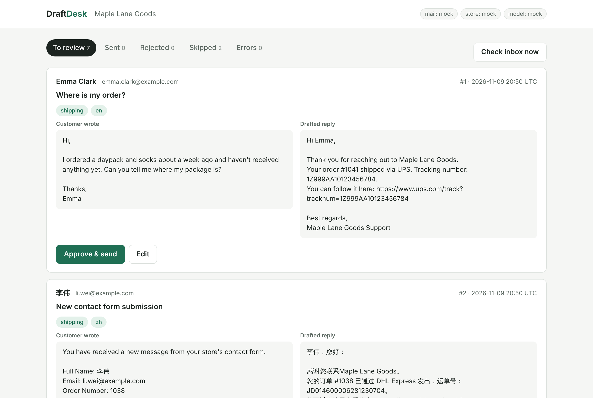
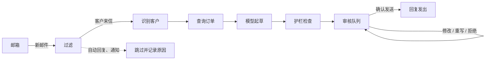

# DraftDesk

**AI 起草回复，人工一键确认发送。没有人点击，任何邮件都不会发出。**

DraftDesk 监听客服邮箱，到店铺后台查询客户订单，让大模型依据你自己的政策文档写好回信，然后放进审核队列。电商平台、邮箱服务和 AI 模型都通过适配器接入，可以任意替换。

[English](README.md)



## 一分钟体验

不需要任何账号或 API key。演示模式用示例数据跑完整流程，模型部分由一个基于规则的替身代替。需要 Python 3.10 或更高版本。

```bash
python3 -m venv .venv
```

```bash
source .venv/bin/activate
```

Windows 上改用 `py -m venv .venv` 和 `.venv\Scripts\activate`。

```bash
pip install -e .
```

```bash
draftdesk demo
```

打开 http://127.0.0.1:8000 。示例收件箱里有 9 封邮件，每封对应一种关键行为：

| 邮件 | DraftDesk 的处理 |
|---|---|
| 英文“我的订单在哪” | 查到订单，引用真实运单号，提供一键发送 |
| 平台转发的联系表单（中文） | 从表单正文取出客户真实邮箱，用中文回复给客户而不是平台 |
| 西班牙语询问订单状态 | 用西班牙语回复当前状态 |
| 商品损坏、要求退款 | 起草安抚性回复，标记为敏感话题，关闭一键发送 |
| 询问别人的订单号 | 不把该订单信息交给模型，并标记该邮件 |
| “忽略你之前的指令……” | 标记为疑似提示词注入 |
| 尺码咨询 | 标记需人工处理（演示替身无法回答开放问题） |
| 自动回复、平台通知 | 跳过，并记录原因 |

## 工作流程



1. **过滤**：自动回复、群发邮件、平台通知、内部邮件直接跳过，并记下原因。
2. **识别客户**：平台常用自己的地址转发联系表单。DraftDesk 从表单正文或 Reply-To 找出真实客户，而且只对你配置的转发地址才信任这些字段。
3. **查询订单**：从店铺 API 取最近订单、商品和物流。只有订单邮箱与来信人一致才会使用。
4. **起草**：模型拿到政策文档、订单数据和邮件，返回回复正文、分类、语言，以及给审核人的备注。
5. **检查**：用确定性的代码把草稿和数据对比，草稿里出现的链接、订单号、运单号如果不来自你的系统，就会被标记。
6. **审核**：没有标记的草稿在队列里直接显示“确认发送”按钮；有标记的必须先打开查看。审核人可以修改、附带要求让模型重写，或者拒绝。

## 支持的平台

| 层 | 已内置 | 自行扩展需要实现 |
|---|---|---|
| 邮箱 | Microsoft 365（Graph）、Gmail、任意 IMAP + SMTP | `EmailProvider`（3 个方法） |
| 电商 | BigCommerce、Shopify、WooCommerce，或不接 | `CommerceProvider`（1 个方法） |
| 模型 | Claude（Anthropic SDK）、任意兼容 OpenAI 接口的服务（OpenAI、Azure OpenAI、Ollama、vLLM 等） | `LLMProvider`（1 个方法） |

切换平台只需改 `config.yaml`，不用改代码。详见 [docs/adapters.md](docs/adapters.md)。

**验证情况说明**：核心流水线、护栏和审核面板有端到端测试。对接外部服务的适配器是用模拟的 HTTP 响应测试的，没有连接真实账号验证过。正式使用前，需要在你自己的环境里核对凭据、权限和字段映射，[docs/adapters.md](docs/adapters.md) 列出了每个适配器要核对的内容。

## 接入自己的系统

```bash
cp config/config.example.yaml config/config.yaml
```

```bash
cp .env.example .env
```

编辑这两个文件，把政策文档放进 `knowledge/`，然后运行：

```bash
draftdesk serve -c config/config.yaml
```

审核方式有两种：

- `dashboard`（默认）：在 DraftDesk 网页上确认并发送。
- `mailbox`：草稿直接存进邮箱自己的草稿箱，挂在原邮件会话下，照常从 Outlook 或 Gmail 发送。这种方式不需要发信权限。

其他命令：`draftdesk run-once`（适合定时任务）、`draftdesk poll`、`draftdesk providers`。

## 设计取舍

- **每封邮件都由人发送**：没有自动发送的开关。模型没有任何工具，不能执行操作，最坏的结果只是写出一封会被审核人看到的差草稿。
- **护栏不依赖模型自觉**：模型会被要求标注不确定的地方，但编造的链接、订单号和运单号是由普通代码对比数据查出来的。
- **客户邮件是不可信输入**：邮件放在带分隔标记的区块里交给模型，并说明这是要回答的内容而不是指令。订单信息只在邮箱匹配时提供，所以仅凭订单号拿不到别人的物流或地址。
- **一套提示词适配所有模型**：提示词构造和输出解析是共用的，每个模型适配器收到的指令和返回的结构都相同。提示词里不变的部分（规则和知识库）与每封邮件变化的部分分开，支持提示词缓存的服务可以复用前者。
- **重复投递不会重复处理**：每个邮件 ID 都会登记（包括跳过和失败的），发送时以原子方式占用草稿，所以重复收到的邮件不会起草两次，连点两下也不会发两次。
- **全程留痕**：每份草稿都保存原邮件、交给模型的数据、标记，以及谁在什么时候做了什么的审计记录。

更多内容：[架构](docs/architecture.md) · [安全](docs/security.md) · [部署](docs/deployment.md)（英文）

## 开发

```bash
pip install -e ".[dev]"
```

```bash
pytest -q
```

共 41 个测试，离线运行，约两秒完成。

## 局限与后续方向

- 只支持纯文本回复，来信的附件会被忽略。
- 每次请求都带上整个知识库（有大小上限），文档量很大时需要改用检索。
- 采用轮询而不是推送，新邮件按配置的间隔（默认两分钟）被处理。
- 单进程加 SQLite，适合一个客服邮箱；多邮箱需要换成共享数据库和任务队列。
- 还没有评测工具，无法在一批标注过的历史邮件上对比不同模型。

## 作者

由 Shang Ma 借助 Claude Code 完成。欢迎在 [LinkedIn](https://www.linkedin.com/in/shang-ma-016354228) 或 GitHub Issues 中提问和反馈。

## 许可证

MIT
