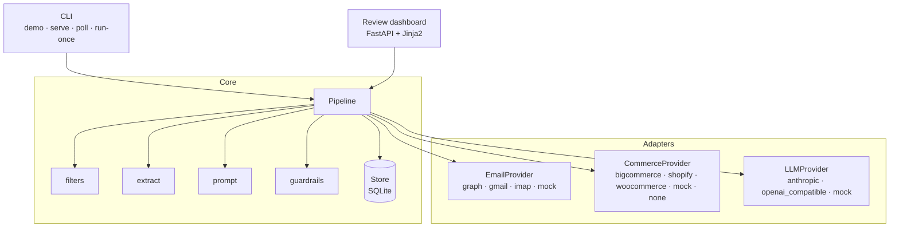
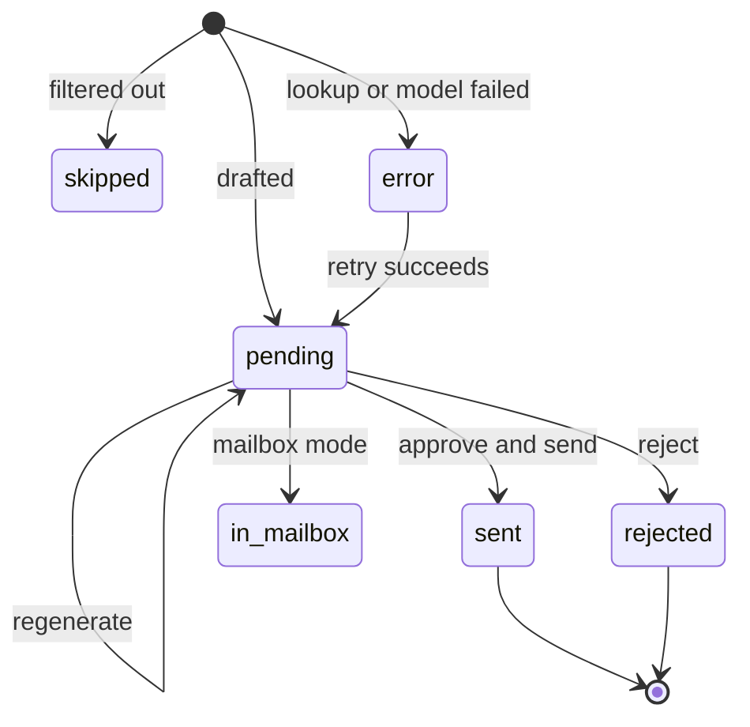

# Architecture

## Components

| Module | Responsibility |
|---|---|
| `pipeline.py` | Orchestrates intake and the review actions (send, reject, regenerate). The only module that touches all three adapters. |
| `filters.py` | Decides whether an email should get a draft. Returns a human-readable skip reason. |
| `extract.py` | Resolves the real customer address and any order number mentioned. |
| `prompt.py` | Builds the system and user prompts; parses and validates model output. Shared by every model adapter. |
| `guardrails.py` | Deterministic checks on each draft. Produces the flags shown to the reviewer. |
| `store.py` | SQLite: one row per inbound message, an audit log, and polling cursors. |
| `registry.py` | Maps provider names in the config to adapter classes, imported lazily. |
| `config.py` | YAML loading, `${ENV}` interpolation, knowledge-base loading. |
| `web/` | The review dashboard. |

## Data flow for one email

1. `EmailProvider.fetch_new(cursor)` returns normalised `InboundEmail` objects and a new cursor.
2. The pipeline checks the store for the message id. Seen ids are counted as duplicates and ignored.
3. `filters.skip_reason()` either returns a reason (row saved as `skipped`) or lets the email through.
4. `extract.identify_customer()` produces a `CustomerIdentity` (address, name, order number, where the address came from).
5. `CommerceProvider.lookup()` returns orders. The pipeline keeps only those whose email matches the customer; if the order number they mentioned belongs to someone else, that fact becomes a flag and the order is dropped.
6. `LLMProvider.draft()` receives a `DraftRequest` and returns a `DraftResult`.
7. `guardrails.check_draft()` returns a list of flags.
8. The row is saved as `pending` (or the draft is pushed to the mailbox and saved as `in_mailbox`).
9. The cursor is advanced only after the whole batch has rows, so a crash re-fetches instead of losing mail.

Any exception in steps 5 to 7 is caught per email: the row is saved as `error` with the message, and the batch continues. Errors can be retried from the dashboard.

## Draft states

`pending -> sent` is a compare-and-set in SQL (`UPDATE ... WHERE status='pending'`). The send happens only if the claim succeeds; if the provider then fails, the row returns to `pending` and the failure is logged.

## The prompt

The system prompt contains the role, the writing rules, the handling of untrusted input, the output contract and the knowledge base. It is byte-identical for every email, which lets providers that support prompt caching reuse it.

The user message contains the order data, the customer's email inside `<customer_email>` tags, and optionally the reviewer's instruction when a draft is regenerated.

The model returns JSON with five fields: `body`, `language`, `category`, `needs_human`, `reviewer_notes`. The Anthropic adapter enforces this with a JSON schema. The OpenAI-compatible adapter requests JSON mode where available, and `parse_result()` tolerates fenced or wrapped JSON for servers that do not support it.

## Why these choices

**Polling rather than webhooks.** Push notifications need a public HTTPS endpoint and subscription renewal, and each mail provider does it differently. A two-minute poll is well within what a support inbox needs and works identically everywhere, including behind a firewall.

**SQLite.** One support inbox produces tens or hundreds of emails a day. A single file with no server to run is the right size, and the `Store` class is the only place that would change to move to Postgres.

**Server-rendered dashboard.** The review screen is a list, a text area and three buttons. Plain HTML forms keep the project free of a JavaScript toolchain.

**No agent loop.** The model makes exactly one call per email with no tools. Order lookup happens in code before the call, so the model cannot be talked into looking up a different customer.
